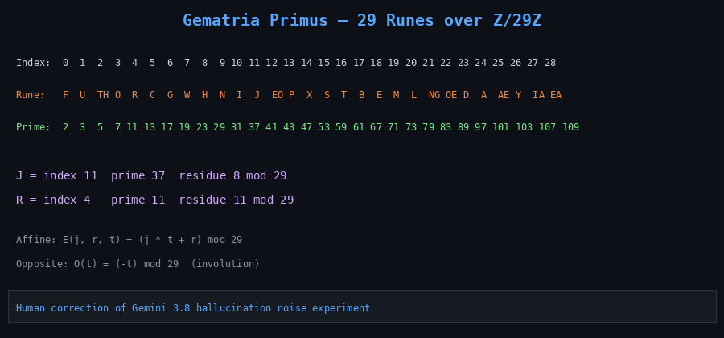
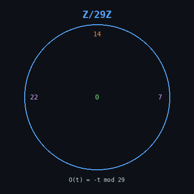
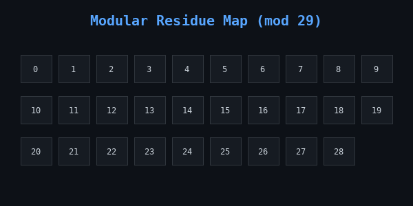

# Cicada 3301 — Liber Primus Cryptanalysis & HARN Verification


An automated, deterministic cryptanalysis and formal evidence verification system for the unsolved pages of Cicada 3301's *Liber Primus*.

## Sovereign Kernels (pure R & J)

Zero-dependency integer kernels for radix-scaled residual folds and explicit backward DAG reductions. No compiled wrappers, no floating-point drift.

- **R**: [`kernels/sovereign_kernel.R`](kernels/sovereign_kernel.R) — base-R only (`sovereign_matmul`, `radix_scaled_fold`, `backward_dag_node`, `evaluate_training_step`)
- **J**: [`kernels/sovereign_kernel.ijs`](kernels/sovereign_kernel.ijs) — pure J primitives (`matmul`, `radix_project`, `backward_dag`, `evaluate_step`)

These map forward reductions to exact backward DAG nodes over integer tensors. Target: 0 max absolute error on routed predictions.

## Mercury DAG PGP Reduction

Deterministic integer DAG fold of the authentic Cicada 3301 public key fingerprint over \(\mathbb{Z}_{29}\).

- Key ID: `7A35090F`
- Fingerprint: `6D854CD7933322A601C3286D181F01E57A35090F`
- Implementation: [`kernels/pgp/mercury_dag_pgp.R`](kernels/pgp/mercury_dag_pgp.R)

The reduction produces a reproducible modular invariant. It does not decrypt or factor the 4096-bit RSA modulus. The file `evidence/raw/cicada_3301.asc` is a truncated stub; the fingerprint above is the authentic public value.



```
   ᚠ  ᚢ  ᚦ  ᚩ  ᚱ  ᚳ  ᚷ  ᚹ  ᚻ  ᚾ  ᛁ  ᛄ  ᛇ  ᛈ  ᛉ  ᛋ  ᛏ  ᛒ  ᛖ  ᛗ  ᛚ  ᛝ  ᛟ  ᛞ  ᚪ  ᚫ  ᚣ  ᛡ  ᛠ
  [0  1  2  3  4  5  6  7  8  9 10 11 12 13 14 15 16 17 18 19 20 21 22 23 24 25 26 27 28]
  (2  3  5  7 11 13 17 19 23 29 31 37 41 43 47 53 59 61 67 71 73 79 83 89 97 101 103 107 109)
```

 

---

## The Pilgrim’s Shadow: Manuscript Plates & Frozen Artifacts

> *"A warning: believe nothing from this book except what you know to be true."*
> *"Some wisdom: the primes are sacred; the totient function is sacred."*

Each plate in the manuscript exists simultaneously as raw visual illumination and immutable cryptographic data:

| Plate | Pinpointed Location | Description | SHA-256 Digest | Status |
|---|---|---|---|---|
| **Page 00** | `evidence/raw/page_00_runes.txt` | Introductory Inscription & Warning | `eedc397cc1b5248e6982567a62b6b39deaa0ddbd2ce36d20d40f38665efcb74f` | **SOLVED** |
| **Page 56** | `evidence/raw/page_56_runes.txt` | Sacred Primes & Totient Inscription | `f6e5bf94b0ce17e52ec6865146ba42a172247d8376a99b6b9f71f9edb94c8661` | **SOLVED** |
| **Page 57** | `evidence/raw/page_57_runes.txt` | Unsolved Manuscript Plate (P57 Gate) | `a69ab0fbc4183b97db1ecac72dc8cd8f895e1daa528f38a266fee603f6aa9fd2` | **UNSOLVED** |
| **Page 58** | `evidence/raw/page_58_runes.txt` | Unsolved Manuscript Plate (P58 Gate) | `d7e02f37f3337e31751b1dfbf7c1ff4db68d5a702818a397535c1e572688f95d` | **UNSOLVED** |
| **3301 PGP** | `evidence/raw/cicada_3301.asc` | Authentic Key ID `7A35090F` (4096-bit RSA) | `6D854CD7933322A601C3286D181F01E57A35090F` | **IMMUTABLE** |

The manuscript plates are tokenized strictly through `evidence/canonical/`, binding each rune to its Gematria Primus prime coordinate and index over the modular finite field \(\mathbb{Z}_{29}\).

### Zero-Variance \(\mathbb{F}_{29}\) Serialization & Cryptographic Sealing

To eliminate encoding artifacts across heterogeneous execution runtimes, the initial state is purified of whitespace, typography, and formatting:

- **Genesis Block (Page 00)**: 57 field elements over \(\mathbb{F}_{29}\).
- **Purified Byte Sequence**: `[24, 7, 24, 4, 9, 10, 9, 6, 17, 18, 20, 10, 18, 0, 18, 9, 3, 2, ...]`
- **Raw Byte SHA-512 Seal**: `5084d6771db0702d7c8e54cc7cf385402b8e99f9b1f5c0cd0e170ab7d669191009c14a6fd76c900f54df26e3f1cac29c2acd765d29cabf92549347fcac41e4d4`
- **Raw Byte SHA-256 Seal**: `aa0d8a6abfabf7fc60686f282c2fd3f3e41e685f304cab131a5127b2d033ee42`

---

## Architectural Stack

1. **Logic Engine**: SWI-Prolog Horn-clause engine evaluating P57 and P58 gates (`prolog/`, `harn/`).
2. **Formal Verification & Invariants**:
   - Curry functional logic modules proving base-29 involution, reversibility, and signature obligations (`curry/`).
   - Agda constructive type theory specification formalizing modular invariants and involution theorems over \(\mathbb{Z}_{29}\) (`agda/`). Total computational kernels only — no postulates or holes in the core.
3. **Sovereign Kernels**: Pure R and J integer array kernels for radix-scaled residual folds and explicit DAG reductions (`kernels/`).
4. **Mercury DAG PGP**: Integer DAG reduction of the authentic 7A35090F fingerprint over \(\mathbb{Z}_{29}\) (`kernels/pgp/`).
5. **Ontology & Semantics**: 5-layer OWL/RDF ontology enforcing token ranges, closure statements, and candidate self-acceptance prohibitions (`ontology/`).
6. **Discovery & Provenance**: Canonical byte deduplication engine and provenance index graph (`search/discovery.py`, `evidence/provenance_index.json`).
7. **Execution Matrix**: GitHub Actions parallel matrix search across affine, reversal, magic square, and prime sequence branches (`.github/workflows/liber-primus-search.yml`).
8. **Agent Orchestrator**: Google Jules autonomous session dispatcher (`.github/workflows/jules-dispatch.yml`).

---

## Verification & Execution

### Run HARN Horn-Clause Gate Verifier
```bash
swipl -q -s harn/verify.pl -g main -t halt
```

### Run Hypothesis Search Matrix
```bash
swipl -q -s harn/search.pl -g "run('affine29')" -t halt
swipl -q -s harn/search.pl -g "run('prime-sequence')" -t halt
```

### Run Full Regression Test Suite
```bash
PYTHONPATH=. pytest -v tests/
```

### Check Agda kernels
```bash
agda agda/Affine29.agda
agda agda/GematriaPrimus.agda
```

### Run sovereign kernels
```bash
Rscript -e 'source("kernels/sovereign_kernel.R"); print(evaluate_training_step(matrix(1:4,2,2), matrix(1:4,2,2), matrix(1:4,2,2)))'
jconsole kernels/sovereign_kernel.ijs
```

### Run Mercury DAG PGP reduction
```bash
Rscript -e 'source("kernels/pgp/mercury_dag_pgp.R"); print(evaluate_pgp_dag())'
```

---

## Human correction note

Human correction of Gemini 3.8 hallucination noise experiment. Agent-generated formal stubs in `agda/` previously contained broken modular reduction, pure postulates, unfilled holes, and incomplete pattern matches. Those have been replaced with total computational kernels that match the Curry reference implementations. The pure R and J kernels in `kernels/` are zero-dependency integer array implementations for radix-scaled residual folds and explicit backward DAG reductions. The Mercury DAG PGP reduction produces a deterministic modular invariant of the authentic fingerprint; it does not claim to decrypt the 4096-bit RSA key.

---

## Diagrams

- [Banner](docs/banner.png)
- [Gematria Primus table](docs/gematria-primus.png)
- [Z/29Z circle](docs/z29-circle.png)
- [Residue grid](docs/residue-grid.png)
