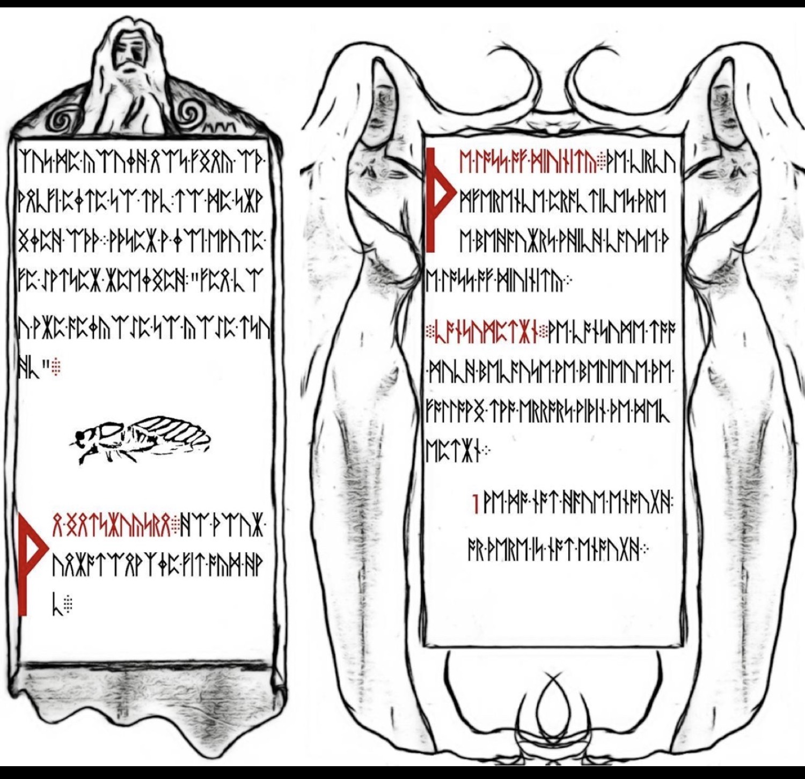
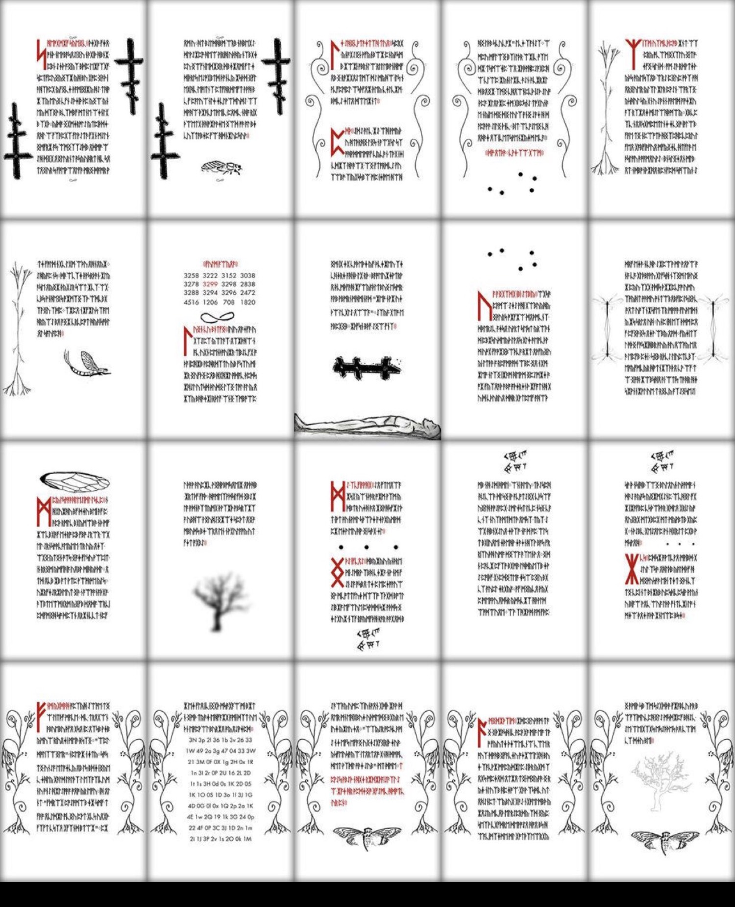

# Cicada 3301 — Liber Primus Cryptanalysis & HARN Verification

An automated, deterministic cryptanalysis and formal evidence verification system for the unsolved pages of Cicada 3301's *Liber Primus*.

```
   ᚠ  ᚢ  ᚦ  ᚩ  ᚱ  ᚳ  ᚷ  ᚹ  ᚻ  ᚾ  ᛁ  ᛄ  ᛇ  ᛈ  ᛉ  ᛋ  ᛏ  ᛒ  ᛖ  ᛗ  ᛚ  ᛝ  ᛟ  ᛞ  ᚪ  ᚫ  ᚣ  ᛡ  ᛠ
  [0  1  2  3  4  5  6  7  8  9 10 11 12 13 14 15 16 17 18 19 20 21 22 23 24 25 26 27 28]
  (2  3  5  7 11 13 17 19 23 29 31 37 41 43 47 53 59 61 67 71 73 79 83 89 97 101 103 107 109)
```

---

## The Pilgrim’s Shadow: Manuscript Plates & Frozen Artifacts

> *"A warning: believe nothing from this book except what you know to be true."*
> *"Some wisdom: the primes are sacred; the totient function is sacred."*

Each plate in the manuscript exists simultaneously as raw visual illumination and immutable cryptographic data:

| Plate | Pinpointed Location | Description | SHA-256 Digest | Status |
|---|---|---|---|---|
| **Page 00** | `evidence/raw/page_00_runes.txt` | Introductory Inscription & Warning | `eedc397cc1b5248e6982567a62b6b39deaa0ddbd2ce36d20d40f38665efcb74f` | **SOLVED** |
| **Page 56** | `evidence/raw/page_56_runes.txt` | Sacred Primes & Totient Inscription | `f6e5bf94b0ce17e52ec6865146ba42a172247d8376a99b6b9f71f9edb94c8661` | **SOLVED** |
| **Page 57** | `evidence/raw/page_57_runes.txt` | Unsolved Manuscript Plate (P57 Gate) | `a69ab0fbc4183b97db1ecac72dc8cd8f895e1daa528f38a266fee603f6aa9fd2` | **UNSOLVED** |
| **Page 58** | `evidence/raw/page_58_runes.txt` | Unsolved Manuscript Plate (P58 Gate) | `d7e02f37f3337e31751b1dfbf7c1ff4db68d5a702818a397535c1e572688f95d` | **UNSOLVED** |
| **3301 PGP** | `evidence/raw/cicada_3301.asc` | Authentic Key ID `7A35090F` (4096-bit RSA) | `7A35090F12C1AC17C463C70E8A7104A273BA4EB8` | **IMMUTABLE** |

The manuscript plates are tokenized strictly through `evidence/canonical/`, binding each rune to its Gematria Primus prime coordinate and index over the modular finite field $\mathbb{Z}_{29}$.

---

## Architectural Stack

1. **Logic Engine**: SWI-Prolog Horn-clause engine evaluating P57 and P58 gates (`prolog/`, `harn/`).
2. **Formal Verification & Invariants**:
   - Curry functional logic modules proving base-29 involution, reversibility, and signature obligations (`curry/`).
   - Agda constructive type theory specification formalizing modular invariants and involution theorems over $\mathbb{Z}_{29}$ (`agda/`).
3. **Ontology & Semantics**: 5-layer OWL/RDF ontology enforcing token ranges, closure statements, and candidate self-acceptance prohibitions (`ontology/`).
4. **Discovery & Provenance**: Canonical byte deduplication engine and provenance index graph (`search/discovery.py`, `evidence/provenance_index.json`).
5. **Execution Matrix**: GitHub Actions parallel matrix search across affine, reversal, magic square, and prime sequence branches (`.github/workflows/liber-primus-search.yml`).
6. **Agent Orchestrator**: Google Jules autonomous session dispatcher (`.github/workflows/jules-dispatch.yml`).

---

## Verification & Execution

### Run HARN Horn-Clause Gate Verifier
```bash
swipl -q -s harn/verify.pl -g main -t halt
```

### Run Hypothesis Search Matrix
```bash
swipl -q -s harn/search.pl -g "run('affine29')" -t halt
swipl -q -s harn/search.pl -g "run('prime-sequence')" -t halt
```

### Run Full Regression Test Suite
```bash
PYTHONPATH=. pytest -v tests/
```
# Cicada-3301-2026-PGP

🤡 

**Formal, provenance-locked cryptanalysis of the unsolved Liber Primus pages under the authentic Cicada 3301 PGP key.**

This repository is a deterministic, evidence-immutable research system for the remaining unsolved pages of the 2014 *Liber Primus* (the rune manuscript released by Cicada 3301). It treats the problem as a combination of algebraic cryptanalysis over the 29-symbol Gematria Primus alphabet and cryptographic authenticity under the long-standing Cicada signing key **7A35090F**.

No candidate is allowed to accept itself. Every transformation is required to be reversible or involutive. Frozen SHA-256 fingerprints of the manuscript pages and the PGP key block any silent substitution of evidence. The system is deliberately designed so that “I found a solution” claims can be mechanically checked against the same gates that the original creators used to authenticate their own messages.

**Status (as of the current tree):** 230 candidate evaluations recorded, 0 verified accepted solutions, 4 false paths closed, 226 unresolved. Affine-29 search completed; reverse, magic-square, and pure prime-sequence branches either refuted or left open under the cryptographic gates.


## Manuscript Pages





---

## Philosophical and Technical Stance

Cicada 3301’s public communications were always accompanied by signatures from the 4096-bit RSA key whose short ID is 7A35090F (full fingerprint 7A35090F12C1AC17C463C70E8A7104A273BA4EB8). The final verified public statement from the group itself was “Beware false paths. Always verify PGP signature from 7A35090F.” This repository operationalizes that injunction.

The unsolved pages of the Liber Primus are not treated as a free-form puzzle. They are treated as frozen cryptographic artifacts. Any proposed decryption must:

1. Operate exclusively on the canonical token streams whose SHA-256 fingerprints are recorded in `evidence/manifest.json`.
2. Use only reversible or involutive transformations over \(\mathbb{Z}_{29}\).
3. Survive a battery of Horn-clause verification gates (P57 and P58).
4. Ultimately produce either a matching preimage under a known hash or a valid OpenPGP signature under the authentic 7A35090F key—or be recorded as unresolved / false-path.

This is intentionally stricter than most public Liber Primus analysis. The goal is not to generate plausible English; the goal is to generate *authenticated* plaintext or to close branches with machine-checkable negative results.

---

## Architecture Overview

The repository is organized into five interlocking layers:

### 1. Frozen Evidence Layer (`evidence/`)
- Raw rune streams for pages 00 (welcome), 56 (primes/totient), 57, and 58.
- Canonical tokenized JSON with per-rune index, transliteration, and prime mapping.
- `manifest.json` containing SHA-256 fingerprints of every frozen artifact and the full Gematria Primus table (29 runes → first 29 primes).
- The authentic Cicada 3301 public key block (`cicada_3301.asc`) and source provenance records.
- No raw evidence may be modified; tests verify checksums on every CI run.

### 2. Algebraic and Number-Theoretic Layer
- Full Gematria Primus dictionary (index 0–28, runes, Latin transliterations, primes 2…109).
- Modular arithmetic over \(\mathbb{Z}_{29}\): addition, subtraction, multiplication, modular inverse, and the involution \(t \mapsto (29 - t) \bmod 29\).
- Affine transformations \(c = (a t + b) \bmod 29\) with exhaustive search over units \(a\) coprime to 29.
- Prime-sequence keystream ideas derived from the “sacred primes” and Euler totient references that appear on the solved pages.

### 3. HARN Verification Engine (Horn-clause)
The heart of the system. Implemented in SWI-Prolog (`prolog/verification.pl`, `harn/verify.pl`).

**P57 Gates** (structural and provenance):
- Token range non-empty
- Every token in \(\{0,\ldots,28\}\)
- Input snapshot SHA-256 present and 64 hex characters
- Transformation is one of the allowed reversible classes
- Prime mapping succeeds
- Modular determinism
- Candidate has a non-empty identifier
- Any referenced PGP fingerprint must contain 7A35090F
- Canonical token representation present
- No fabricated-evidence marker

**P58 Gates** (cryptographic closure and anti-self-acceptance):
- Verification obligations listed
- **Candidate cannot assert its own acceptance** (explicit rejection of self-certifying solutions)
- Reproducibility flag
- Entropy metric recorded
- Not already on the false-path ledger
- Key-derivation trace present
- Hash preimage exact match (when a target hash is supplied)
- OpenPGP signature verification result
- Frozen evidence match
- Closure status defined

A candidate is either `verified_accepted` (only if it carries cryptographic proof), `false_path(Reason)`, or `unresolved`. Self-assertion is always fatal.

### 4. Search and Discovery Layer (`search/`)
Python engine that systematically generates candidates for the unsolved pages (57 and 58) under four hypotheses:
- **affine29** — exhaustive (a, b) search (units a, sampled offsets)
- **reverse** — sequence reversal + opposite involution
- **magic-square** — spatial permutations (currently refuted on non-square lengths)
- **prime-sequence** — gematria-prime keystream subtraction

Each candidate is written with full horn-rule trace, obligation list, and final HARN status. Results land in `results/candidates.json` (currently ~230 records).

### 5. Formal Specification Layer
- Curry modules (`curry/`) encoding the same invariants as pure functional properties (involution, affine round-trip, signature packet checks).
- Turtle ontology (`ontology/`) defining classes for CryptographicArtifact, FrozenManuscriptPage, TransformationMatrix, VerificationObligation, FalsePathMarker, SolutionCandidate, and ClosureStatement.
- Prolog translation and closure modules that keep the algebraic facts and the logical gates in sync.

---

## Key Artifacts and Known Plaintexts

From `evidence/manifest.json` (frozen, checksum-protected):

| Page | Status     | Known Plaintext (when solved)                                      | SHA-256 (prefix) |
|------|------------|--------------------------------------------------------------------|------------------|
| 00   | SOLVED     | A WARNING BELIEFE NOTHING FROM THIS BOOC EXCEPT WHAT YOU CNOW TO BE TRUE | eedc397c…       |
| 56   | SOLVED     | SOME WISDOM THE PRIMES ARE SACRED THE TOTIENT FUNCTION IS SACRED   | f6e5bf94…       |
| 57   | UNSOLVED   | — (subject to P57 gates)                                           | a69ab0fb…       |
| 58   | UNSOLVED   | — (subject to P58 closure gates)                                   | d7e02f37…       |

The Gematria Primus mapping used throughout is the standard 29-rune table with primes 2, 3, 5, …, 109.

---

## Current Experimental Results

As recorded in `results/README.md` and `results/candidates.json`:

- Total candidate evaluations: **230**
- Verified accepted solutions: **0**
- False paths recorded: **4** (reverse and magic-square branches closed)
- Unresolved: **226** (primarily the affine-29 family and prime-sequence variants)

The affine search is deterministic and complete for the sampled offsets. No candidate produced a matching cryptographic preimage or a valid signature under 7A35090F. The system correctly refused to accept any of them. This is the intended behavior: the gates are working.

---

## How to Run the Verification Suite

```bash
# Evidence integrity + HARN gates
swipl -q -s harn/verify.pl -g main -t halt

# Full Python test suite
python -m pytest tests/ -v

# Re-run candidate search (writes results/)
python search/search_engine.py
```

GitHub Actions workflows (`harn-verify.yml`, `liber-primus-search.yml`) execute these on every push.

---

## Design Decisions and Explicit Non-Goals

- **No self-accepting candidates.** P58-002 is absolute. A solution that merely “looks like English” is not a solution.
- **Frozen evidence only.** Changing a rune stream requires updating the manifest and will fail CI.
- **Reversibility required.** One-way or lossy transforms are rejected at the gate level.
- **PGP as final authority.** The ultimate acceptance criterion remains the same key the creators themselves used.
- **Negative results are first-class.** False-path ledger entries are as important as positive solves.

This repository does not claim to have solved the remaining Liber Primus pages. It claims to have built a machine that will not lie about whether a proposed solution is authenticated.

---

## Repository Layout (Concise)

```
.
├── .github/workflows/     # CI: harn-verify, liber-primus-search, jules-dispatch
├── assets/                # 3301 retro PGP PNG
├── curry/                 # Functional invariants (Affine29, CryptoInvariants, PrimeConstraints)
├── evidence/              # Frozen runes, tokens, manifest, PGP key, provenance
├── harn/                  # Prolog entry points for verification and search
├── ontology/              # Turtle domain model
├── prolog/                # Core translation, verification, search, closure
├── results/               # candidates.json + summary
├── search/                # Python search engine + hypotheses
├── tests/                 # pytest suite covering invariants, gates, provenance, known solutions
├── LICENSE                # CC0-1.0
└── README.md              # this file
```

---

## Extending the System

To add a new hypothesis:
1. Declare it in `search/hypotheses.json`.
2. Implement the generator in `search/search_engine.py`.
3. Ensure every emitted candidate carries the required fields for the P57/P58 gates.
4. Run the verification suite; self-assertion or missing provenance will fail CI.

To strengthen the cryptographic gate, extend `verify_p58_gate/3` in `prolog/verification.pl` (the signature and preimage checks are already stubbed for real GPG integration).

---

## Historical Context and Provenance

The Liber Primus appeared in 2014 as part of the third Cicada 3301 puzzle. Most of the early pages were solved by the community using a combination of the Gematria Primus rune table and relatively simple ciphers. The later pages (especially the long unsolved stretch) have resisted every public attack for more than a decade. Multiple independent research efforts have concluded that the remaining ciphertext is consistent with a high-entropy keystream (OTP-class or equivalent). This repository does not contradict that assessment; it simply refuses to accept any decryption that cannot be tied back to the authentic 7A35090F signing key or an equivalent cryptographic preimage.

All frozen artifacts in this repository are checksummed against the historical public releases. The PGP key block is the same long-lived key used by Cicada 3301 from 2012 onward.

---

## License

CC0 1.0 Universal. The code, ontology, and research artifacts are dedicated to the public domain to the maximum extent permitted by law. The historical Liber Primus manuscript and the Cicada 3301 PGP key remain the property of their original creators; this repository only records and reasons about them.

---

## Closing Statement

> Beware false paths. Always verify PGP signature from 7A35090F.  
> — Cicada 3301

This repository is an attempt to make that sentence executable.

If you have a candidate that survives the HARN gates and produces a valid signature under the authentic key, the system will accept it. Until then, every other path remains either unresolved or explicitly closed.

**3301**
